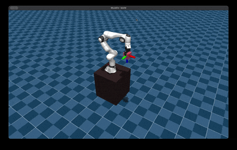
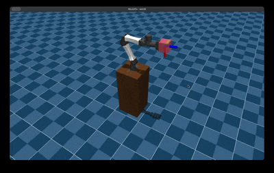
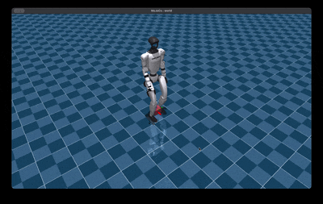

# Examples

## Inverse Kinematics

Just run the following, replace `ROBOT_ID` with one of the identifiers from above:

```bash
python -m molmo_spaces.examples.ex_ik_robots --robot-id ROBOT_ID
```


| Preview | Id |
|---------|----|
|  | `franka-droid` |
|  | `i2rt-yam` |


## G1 navigation

This example uses the [SONIC](https://nvlabs.github.io/GEAR-SONIC/) policy for the `Unitree G1` to navigate in the plane. The user can
translate|rotate the waypoint and the whole body controller will handle the request.

```bash
python -m molmo_spaces.examples.ex_g1_navigation
```


